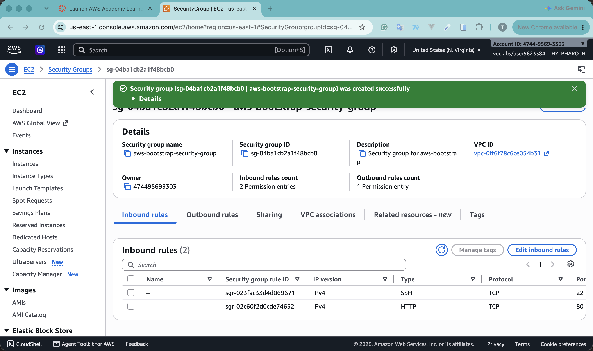
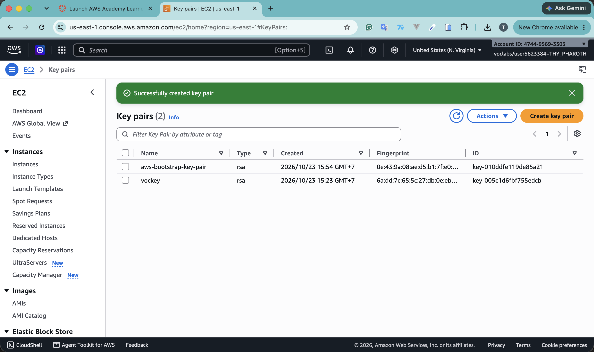
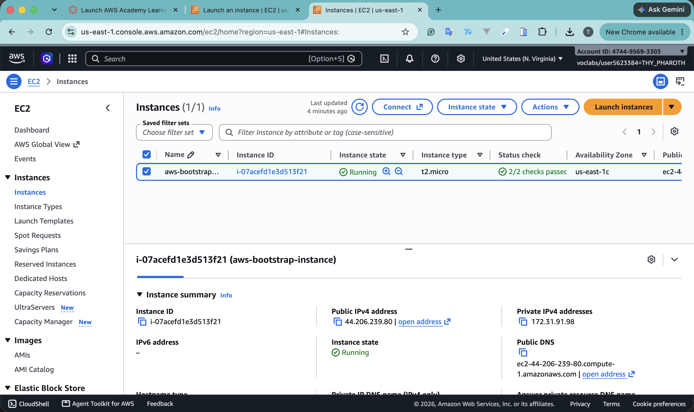
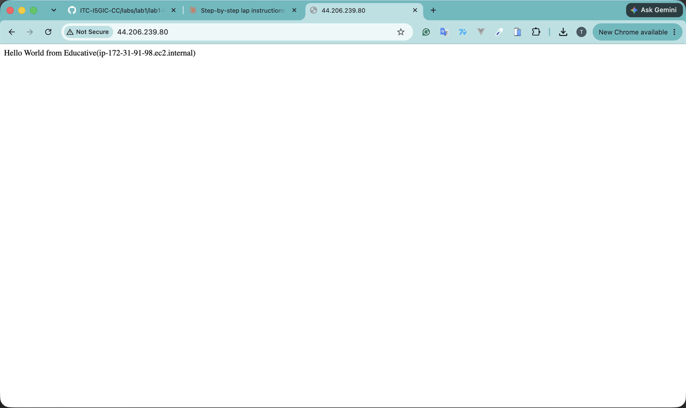
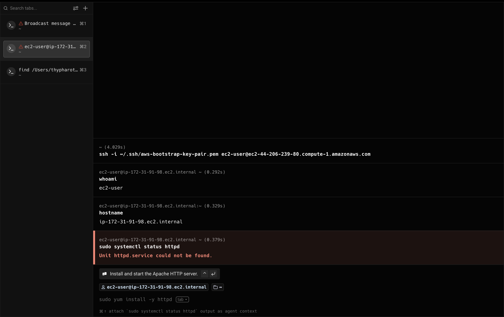
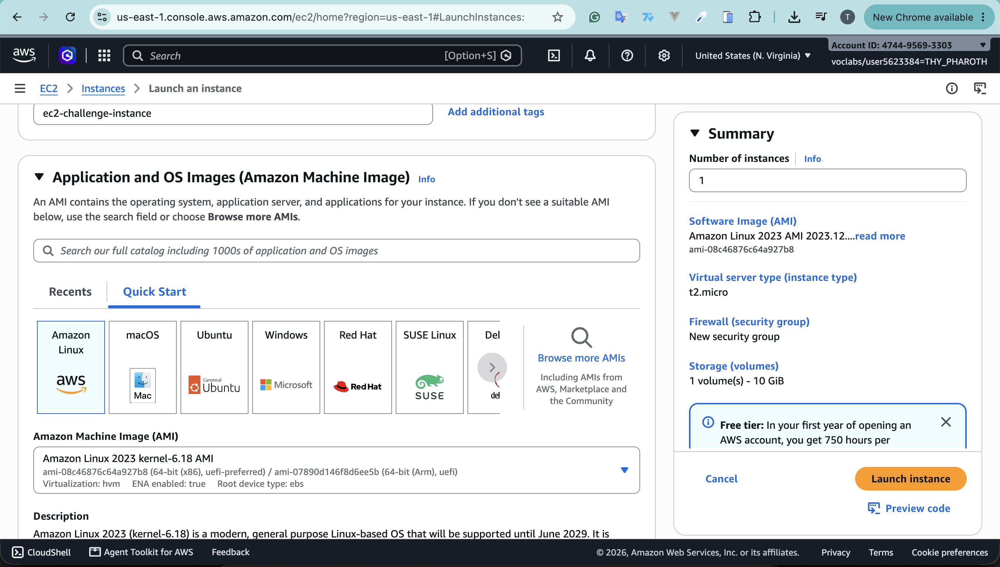
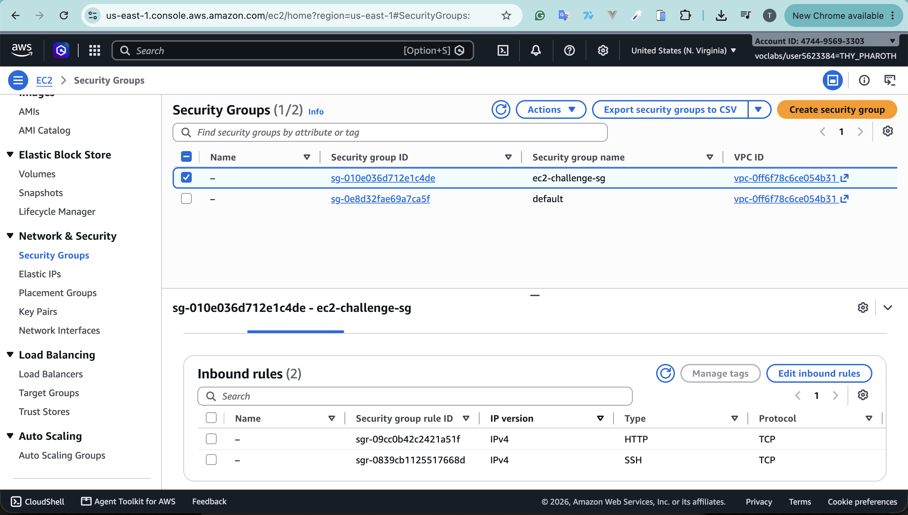
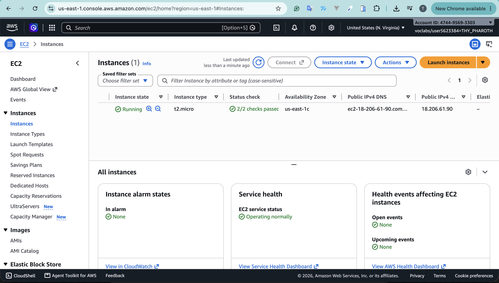
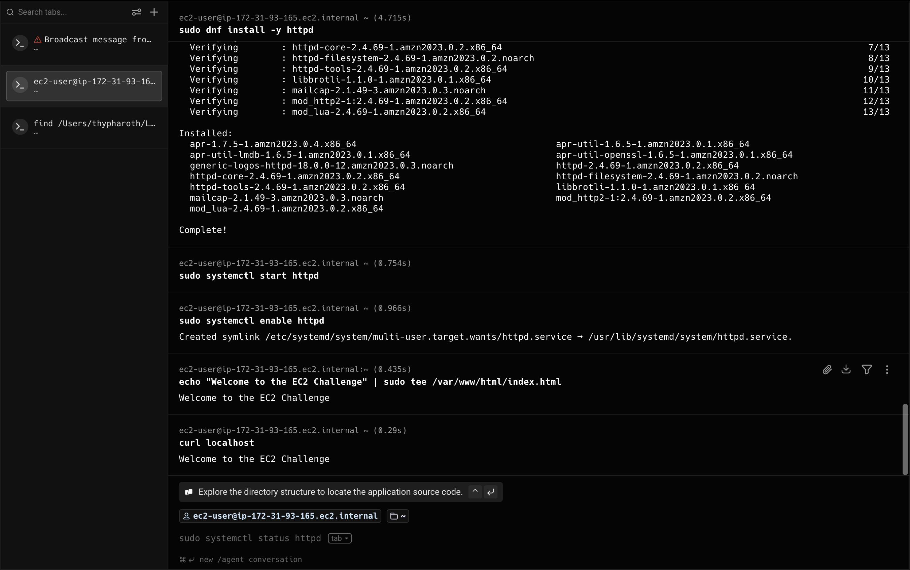
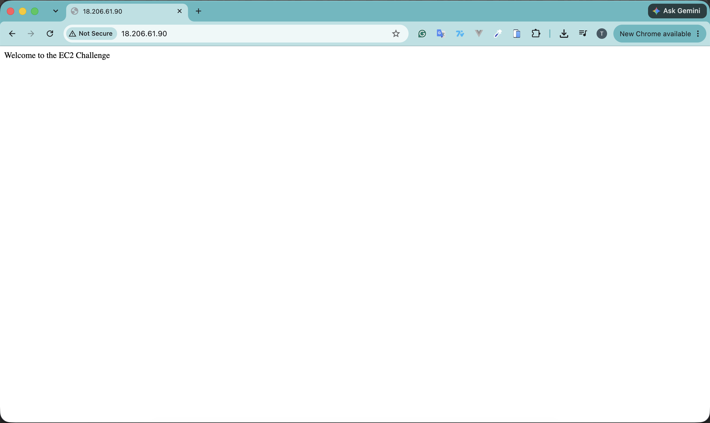

# Cloud Lab 1 Submission — Amazon EC2

- **Student name:** THY PHAROTH
- **Student ID:** e20220886
- **Learner Lab user name:** user5623384
- **Date completed:** 2026-10-24

---

## Part 1.1 — An Amazon EC2 Walkthrough

### Security group



### Key pair



### Instance details



### Browser test



### SSH connection



Did you connect with your own SSH client or with EC2 Instance Connect?

I connected with my own SSH client from the macOS terminal, using the downloaded key pair:

```bash
ssh -i ~/.ssh/aws-bootstrap-key-pair.pem ec2-user@ec2-44-206-239-80.compute-1.amazonaws.com
```

---

## Part 1.2 — EC2 Web Solution (Challenge)

### Launch configuration



### Security group



### Running instance



### Commands on the instance



Paste the commands you ran to install the web server and create `index.html`:

```bash
sudo dnf install -y httpd
sudo systemctl start httpd
sudo systemctl enable httpd
echo "Welcome to the EC2 Challenge" | sudo tee /var/www/html/index.html
curl localhost
```

### Browser test



---

## Questions

1. **Your security group has an SSH rule and an HTTP rule. What does each one let you do? What would stop working if you deleted the HTTP rule?**

   The SSH rule (TCP port 22) allows me to open a remote terminal session on the instance with my key pair. The HTTP rule (TCP port 80) allows browsers to reach the web server running on the instance. If I deleted the HTTP rule, the web page would no longer load from my browser (the request would time out), but SSH would still work, and `curl localhost` from inside the instance would still return the page.

2. **In Part 1.1 you never logged in to install the web server. What installed it, and when did it run?**

   The **User data** script entered in *Advanced details* when launching the instance. EC2 runs it automatically (as root, via cloud-init) only once, on the instance's first boot, so the web app was already installed and running by the time the instance passed its status checks.

3. **Why does the web page open with `http://` but not with `https://`?**

   HTTPS uses port 443 and needs a TLS certificate configured on the web server. The security group only opens port 80, and the server has no certificate or HTTPS listener, so only plain HTTP works (which is why the browser shows "Not Secure").

4. **Part 1.2 asked for a 10 GiB root volume. Where in the launch settings did you set it, and how can you check the size on the running instance?**

   In the **Configure storage** section of the *Launch an instance* page, I changed the root volume (gp3) size from 8 to 10 GiB; the Summary panel shows "1 volume(s) – 10 GiB". On the running instance it can be checked with `lsblk` or `df -h /`, or in the console under the instance's **Storage** tab.

## Clean up

- ✅ Part 1.1: instance terminated, key pair and security group deleted.
- ✅ Part 1.2: instance terminated, security group (and key pair, if any) deleted.
