# Cloud Lab 2 Submission — Load Balancing and Auto Scaling

- **Student name:** THY PHAROTH
- **Student ID:** e20220886
- **Learner Lab user name:** user5623384
- **Date completed:** 2026-10-30

---

## Task evidence

### Load balancer security group

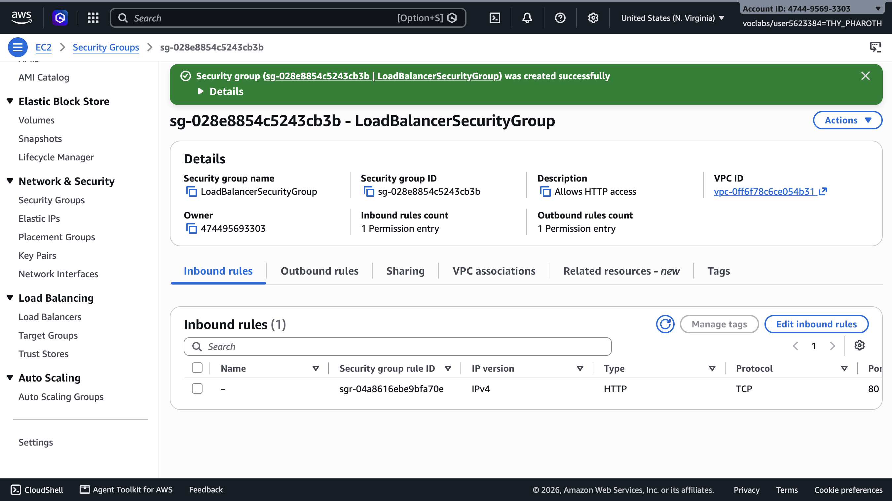

`LoadBalancerSecurityGroup` (sg-028e8854c5243cb3b) was created successfully. It has one inbound rule that allows HTTP (TCP 80), so the load balancer can receive web traffic from the internet.

### Launch template security group


`LaunchTemplateSecurityGroup` (sg-0ba27c81f40c2cb3e) was created with two inbound rules: SSH (TCP 22) and HTTP (TCP 80). The instances launched by Auto Scaling use this group.

### Target group

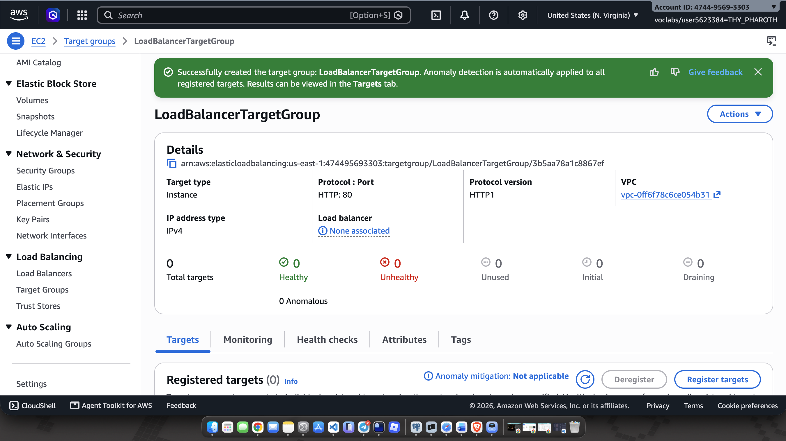

`LoadBalancerTargetGroup` was created with target type **Instance** and protocol **HTTP:80**. At this point it has 0 targets and no load balancer, which is expected because the Auto Scaling group has not been created yet.

### Health checks

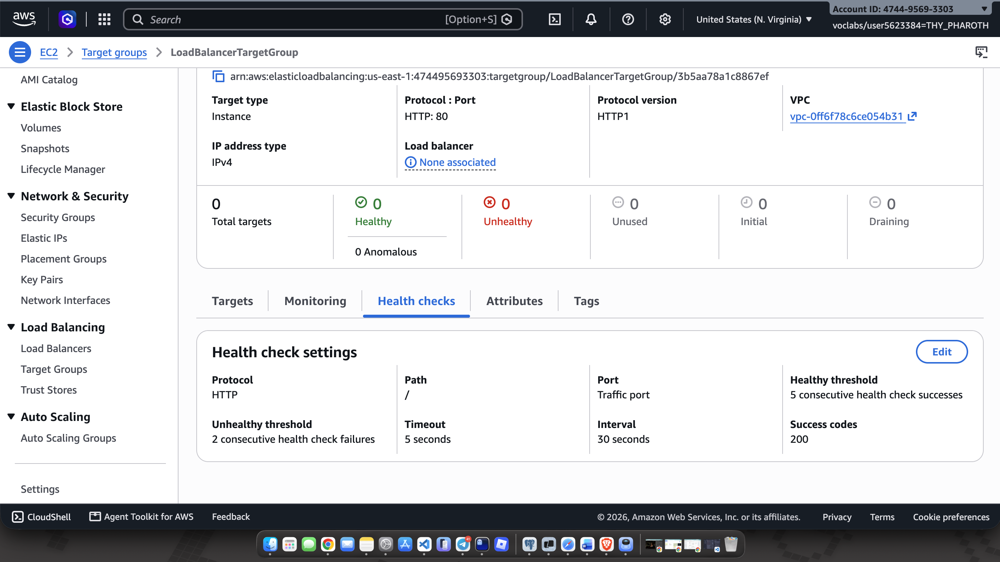

The health check sends HTTP requests to path `/` on the traffic port every 30 seconds and expects code `200`. A target becomes healthy after 5 successes in a row and unhealthy after 2 failures in a row.

### Load balancer

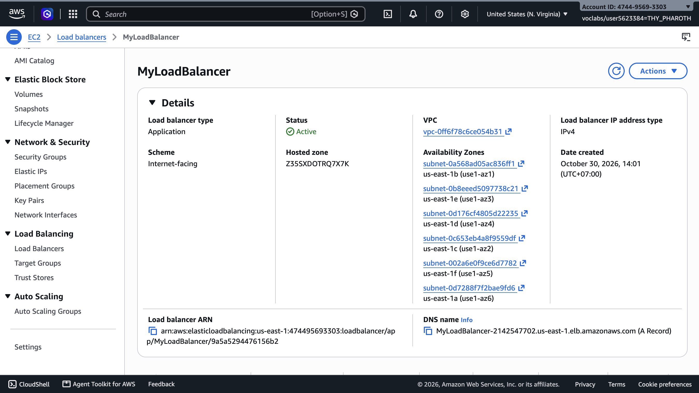

`MyLoadBalancer` is an **Application** load balancer. It is **Internet-facing** and its status is **Active**. It covers six Availability Zones (us-east-1a to us-east-1f) and its DNS name is `MyLoadBalancer-2142547702.us-east-1.elb.amazonaws.com`.

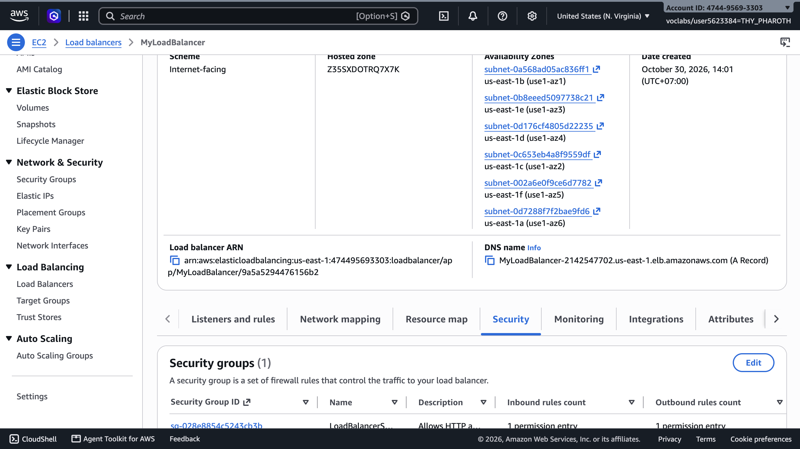

The **Security** tab shows that the load balancer uses `LoadBalancerSecurityGroup` (sg-028e8854c5243cb3b), the HTTP-only group created earlier.

### Launch template

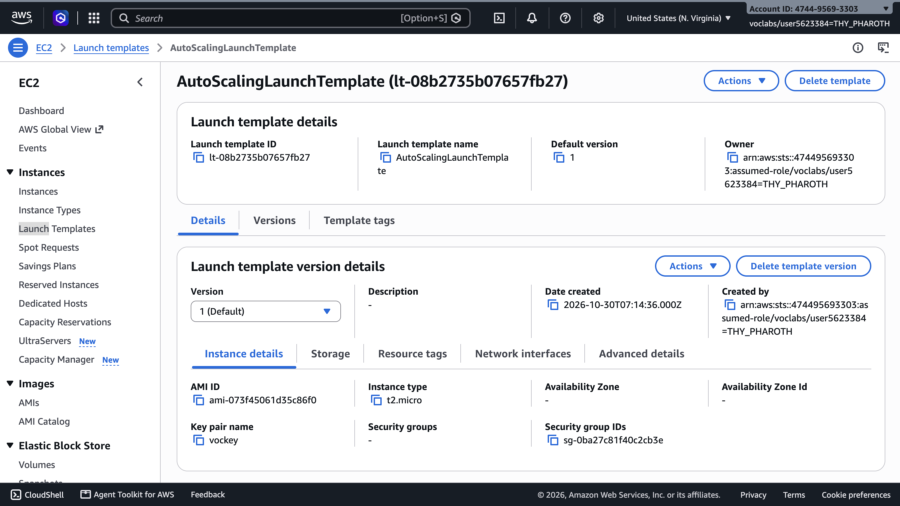

`AutoScalingLaunchTemplate` (lt-08b2735b07657fb27) launches **t2.micro** instances from ami-073f45061d35c86f0, with key pair `vockey` and security group sg-0ba27c81f40c2cb3e.

### Auto Scaling group

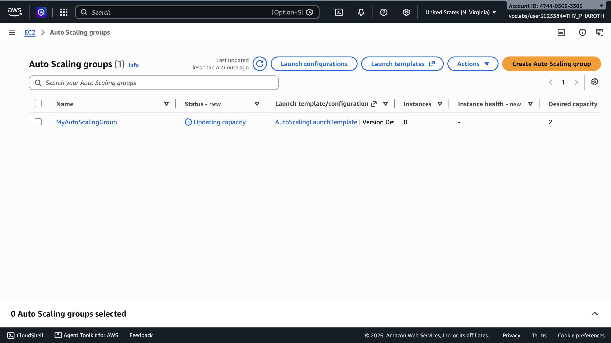

`MyAutoScalingGroup` was created from `AutoScalingLaunchTemplate` with desired capacity 2. Its status is **Updating capacity** because the first instances are still launching.

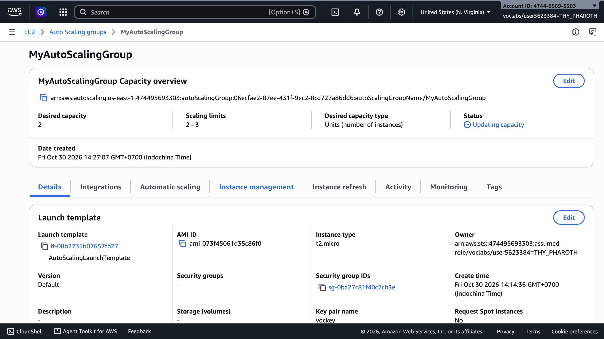

The group has **desired capacity 2** and **scaling limits 2 – 3**, and uses the default version of the launch template.

### Browser test through the load balancer

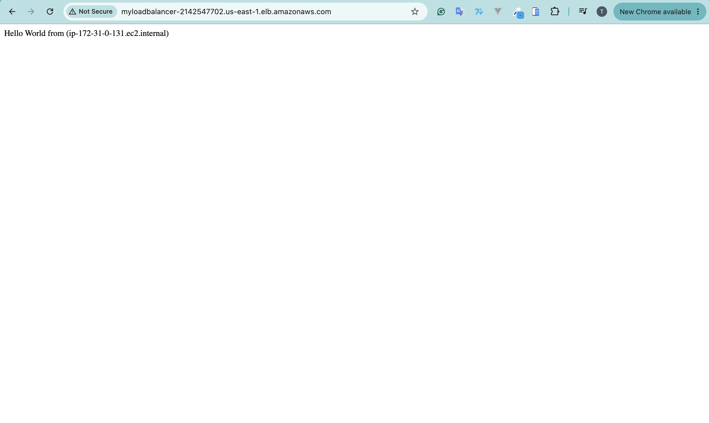

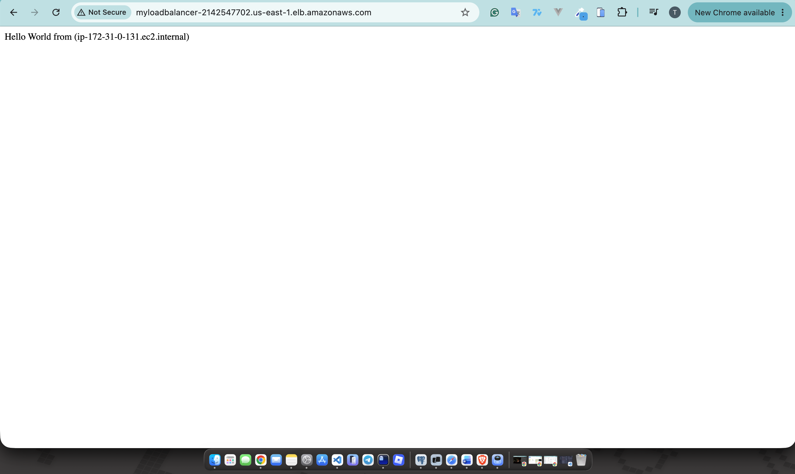

Opening the load balancer DNS name in a browser returns `Hello World from (ip-172-31-0-131.ec2.internal)`. This proves that the load balancer forwards requests to an instance in the Auto Scaling group.

### Stopping the web server

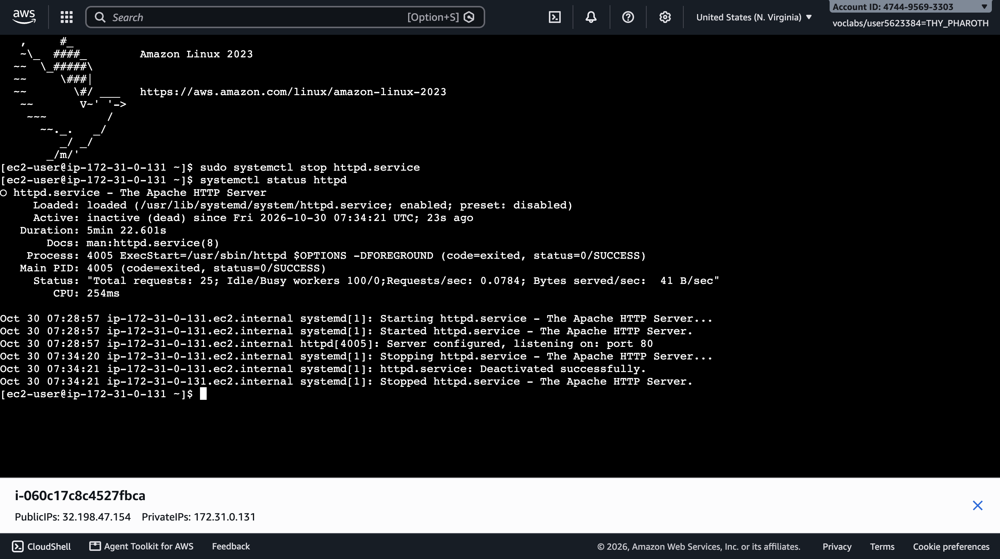

On instance i-060c17c8c4527fbca (ip-172-31-0-131), I ran `sudo systemctl stop httpd.service`. `systemctl status httpd` then shows the service as **inactive (dead)**, so this instance no longer serves the web page.

```bash
sudo systemctl stop httpd.service
systemctl status httpd
```

### Target marked unhealthy

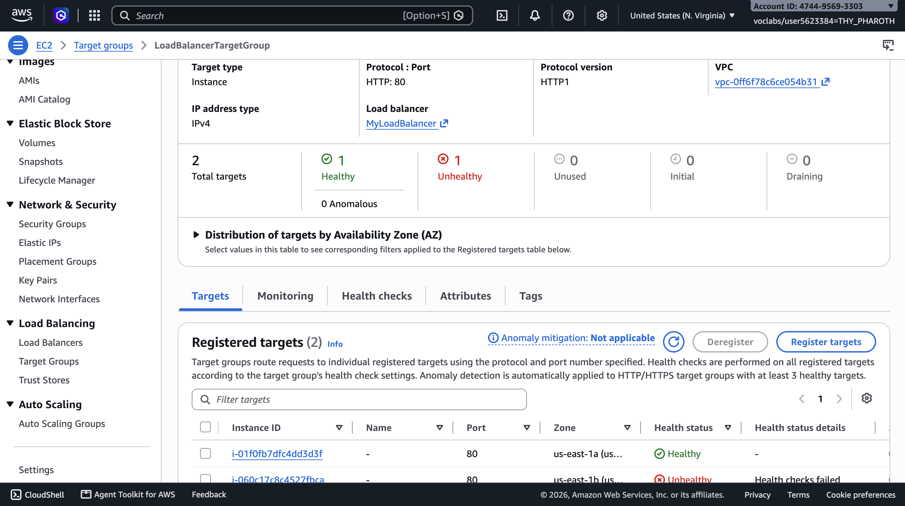

After a few failed health checks, the target group shows 1 healthy target (i-01f0fb7dfc4dd3d3f) and 1 **unhealthy** target (i-060c17c8c4527fbca, "Health checks failed").

### Unhealthy instance replaced

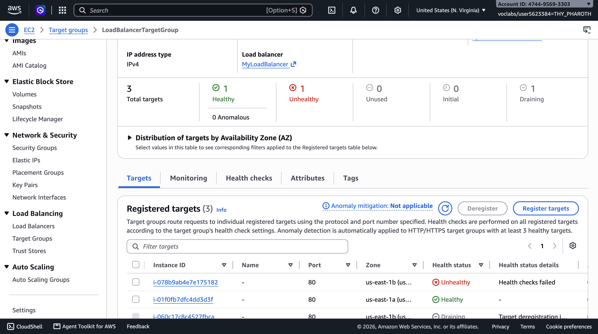

Auto Scaling responds to the failed instance automatically:

- The old instance i-060c17c8c4527fbca is **Draining**, which means it is being deregistered.
- A new instance i-078b9ab4e7e175182 has been launched in us-east-1b to replace it.
- The new instance still shows "Health checks failed" because it is booting. It turns healthy after it passes 5 checks in a row.

---

## Questions

<!-- Answer the lab's questions here, in your own words. -->

1. **Question 1**

   Answer.

2. **Question 2**

   Answer.

---

## Problems and how I solved them (optional)

<!-- An error you met, what caused it, and how you fixed it. -->

## AI note (optional)

<!-- One suggestion an AI tool gave you and how you checked it. -->

## Clean up

- [ ] Auto Scaling group `MyAutoScalingGroup` deleted (this also terminates its instances).
- [ ] Load balancer `MyLoadBalancer` deleted.
- [ ] Target group `LoadBalancerTargetGroup` deleted.
- [ ] Launch template `AutoScalingLaunchTemplate` deleted.
- [ ] Security groups `LaunchTemplateSecurityGroup` and `LoadBalancerSecurityGroup` deleted.
