# Cloud Lab 4 Submission — Amazon VPC (Public and Private Subnets)

- **Student name:** THY PHAROTH
- **Student ID:** e20220886
- **Learner Lab user name:** user5623384
- **Date completed:** 2026-11-18

---

## Task evidence

### VPC

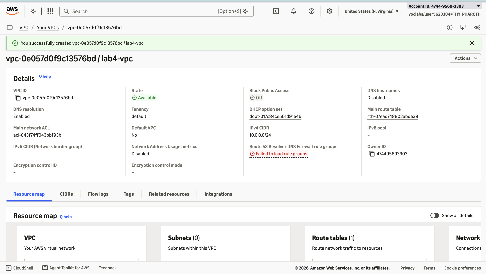

`lab4-vpc` (vpc-0e057d0f9c13576bd) was created with IPv4 CIDR **10.0.0.0/24** and its state is **Available**. AWS also created its main route table (rtb-07ead748802abde39) and main network ACL automatically.

### Internet gateway

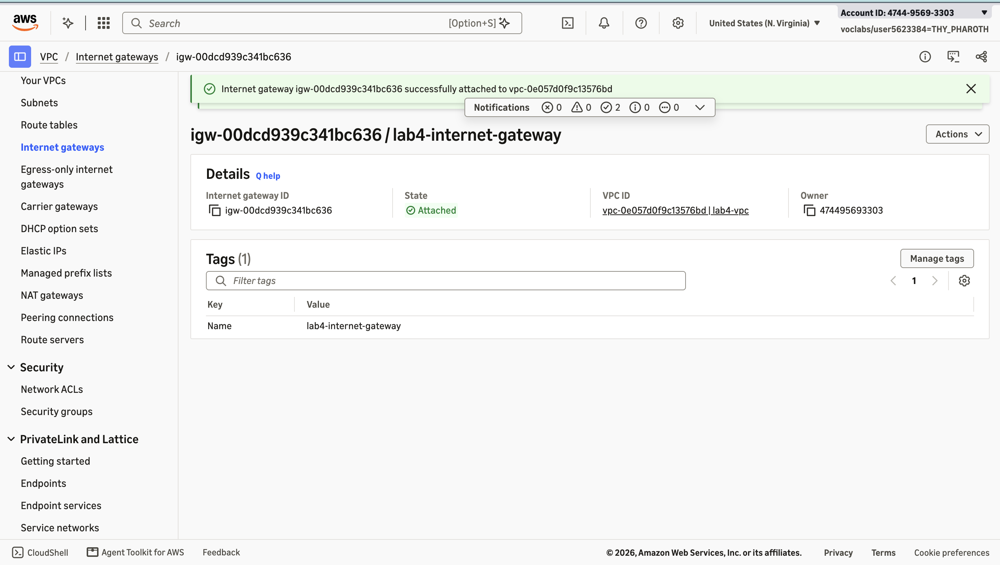

`lab4-internet-gateway` (igw-00dcd939c341bc636) was created and its state is **Attached** to `lab4-vpc`. Without this attachment, nothing in the VPC can reach the internet directly.

### Public subnet

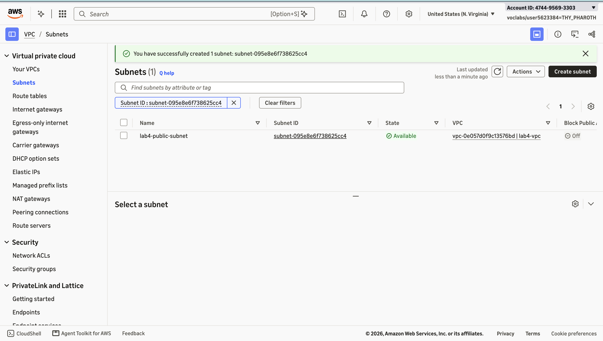

`lab4-public-subnet` (subnet-095e8e6f738625cc4) was created in `lab4-vpc` and is **Available**.

### Public route table

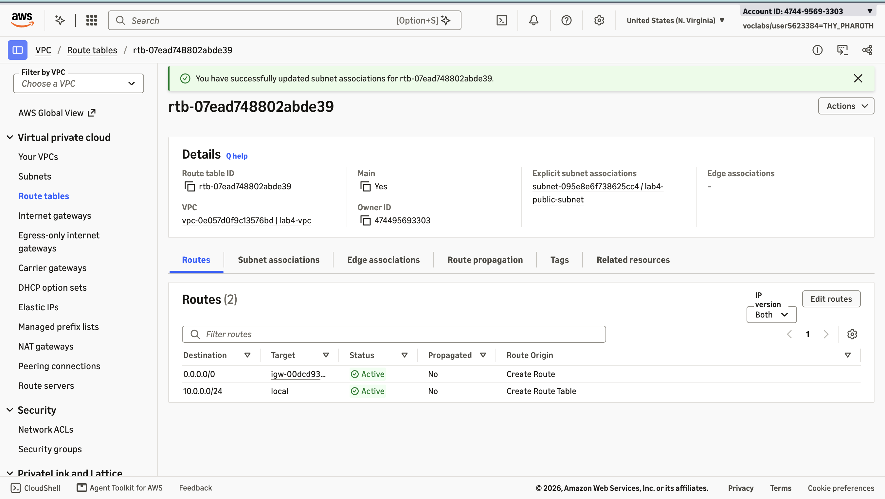

Route table rtb-07ead748802abde39 is associated with `lab4-public-subnet`. It has two active routes:

- `10.0.0.0/24 → local`, for traffic inside the VPC.
- `0.0.0.0/0 → igw-00dcd939c341bc636`, which sends all other traffic to the internet gateway.

The internet gateway route is what makes this subnet *public*.

### EC2 instance in the public subnet

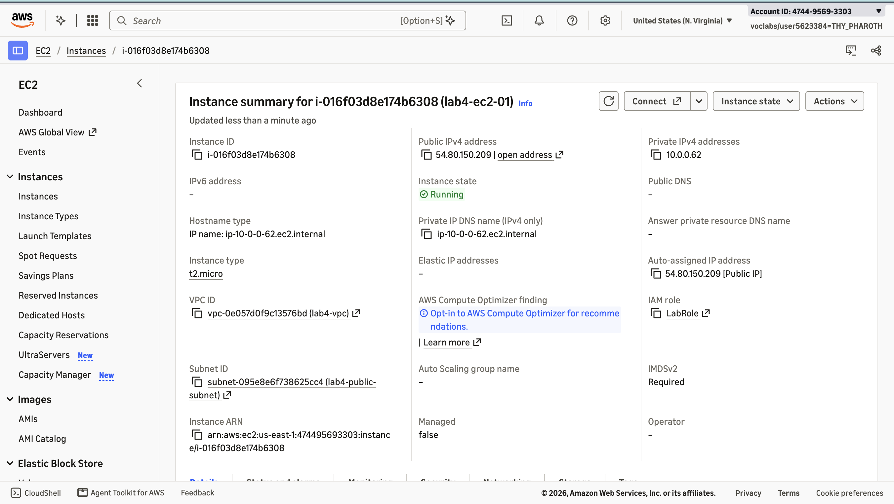

`lab4-ec2-01` (i-016f03d8e174b6308) is **Running** in `lab4-public-subnet`. It has private IP **10.0.0.62** and an auto-assigned public IP **54.80.150.209**, and it uses the `LabRole` IAM role.

### Test from the public instance

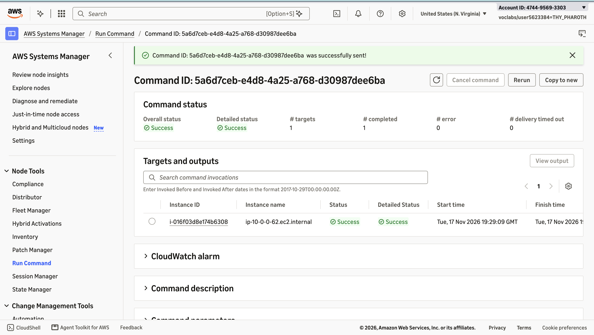

I sent a command to `lab4-ec2-01` with **Systems Manager Run Command** (command ID 5a6d7ceb-e4d8-4a25-a768-d30987dee6ba). It finished with **Success** on 1 of 1 targets with 0 errors, which shows the instance can reach the internet through the internet gateway.

### Private subnet

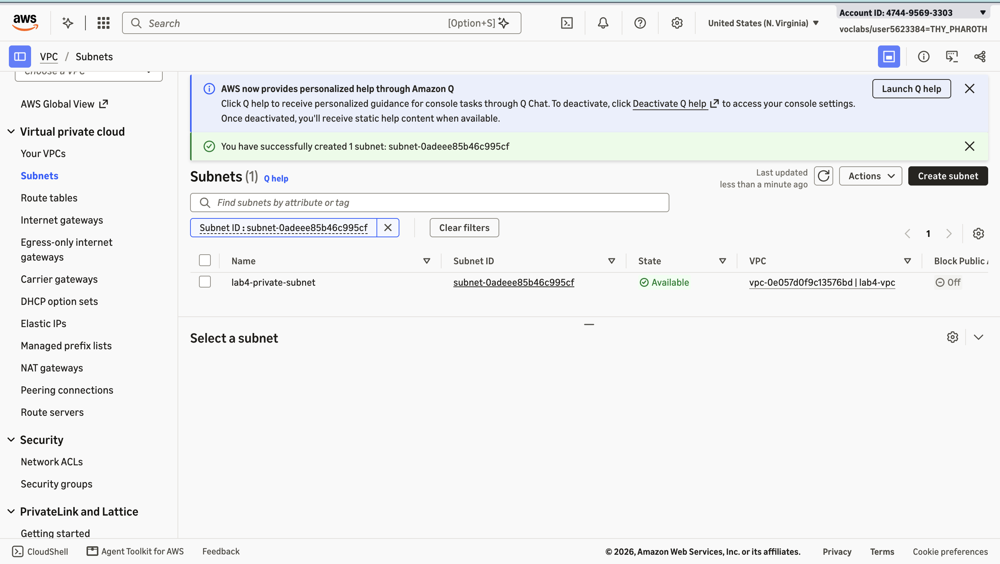

`lab4-private-subnet` (subnet-0adeee85b46c995cf) was created in the same VPC and is **Available**.

### NAT gateway

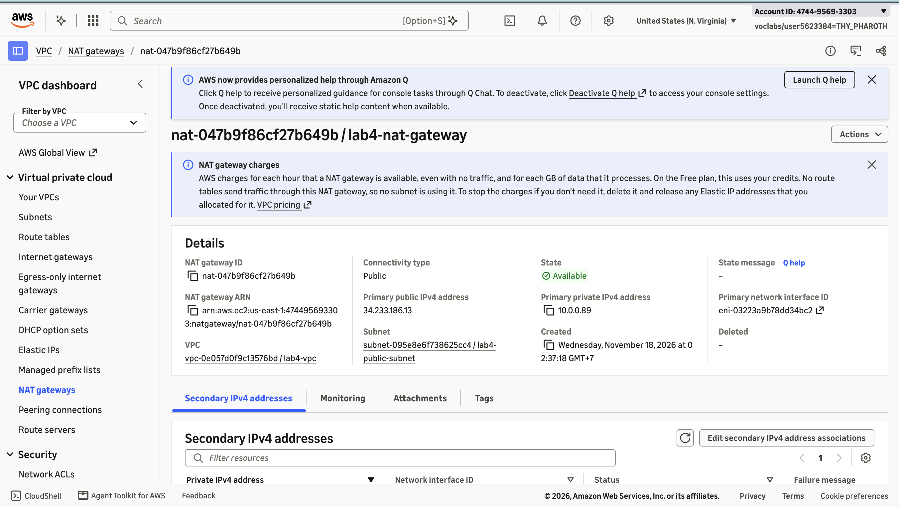

`lab4-nat-gateway` (nat-047b9f86cf27b649b) is **Available**, with connectivity type **Public**. It is placed in `lab4-public-subnet` and has public IP **34.233.186.13** and private IP **10.0.0.89**.

### Private route table

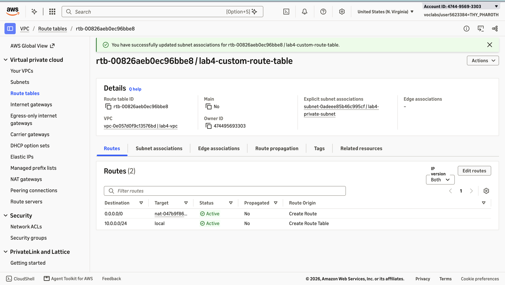

`lab4-custom-route-table` (rtb-00826aeb0ec96bbe8) is associated with `lab4-private-subnet`. Its default route `0.0.0.0/0` points to the **NAT gateway** (nat-047b9f86…) instead of the internet gateway. Instances in this subnet can make outbound connections, but nothing on the internet can start a connection to them.

### EC2 instance in the private subnet

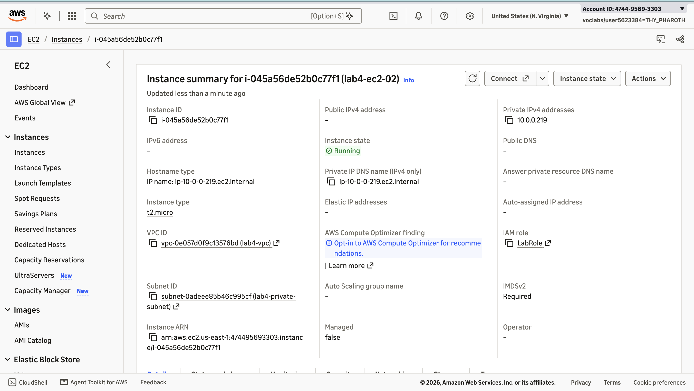

`lab4-ec2-02` (i-045a56de52b0c77f1) is **Running** in `lab4-private-subnet`. It has only a private IP (**10.0.0.219**), and its public IPv4 address is empty (`–`), so it can't be reached directly from the internet.

### Test from the private instance

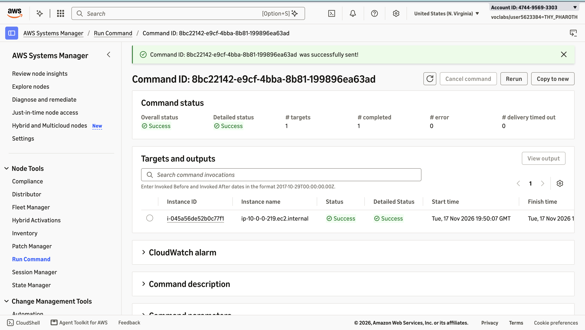

I sent a command to `lab4-ec2-02` with Run Command (command ID 8bc22142-e9cf-4bba-8b81-199896ea63ad). It also finished with **Success**. The instance has no public IP, so its outbound traffic must have gone through the NAT gateway.

<!-- Paste the command you ran and its output, e.g.:
```bash
curl -I https://aws.amazon.com
```
-->

---

## Questions

<!-- Answer the lab's questions here, in your own words. -->

1. **Question 1**

   Answer.

2. **Question 2**

   Answer.

---

## Problems and how I solved them (optional)

<!-- An error you met, what caused it, and how you fixed it. -->

## AI note (optional)

<!-- One suggestion an AI tool gave you and how you checked it. -->

## Clean up

- [x] EC2 instances `lab4-ec2-01` and `lab4-ec2-02` terminated.
- [x] NAT gateway `lab4-nat-gateway` deleted, and its Elastic IP released (both cost money while they exist).
- [x] Route table `lab4-custom-route-table` deleted.
- [x] Subnets `lab4-public-subnet` and `lab4-private-subnet` deleted.
- [x] Internet gateway `lab4-internet-gateway` detached and deleted.
- [x] VPC `lab4-vpc` deleted.
